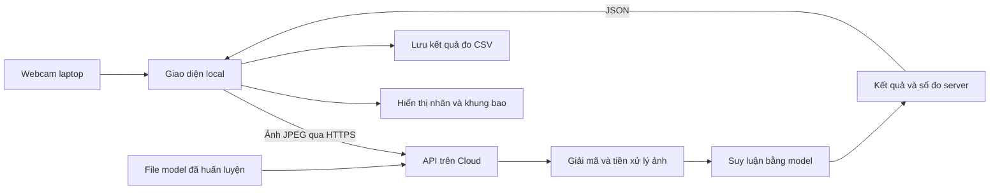

# Lab3: phân tích yêu cầu và lộ trình thực hiện từ đầu

> Tài liệu brainstorm cũ, giữ để tham khảo. Phạm vi lab đã rút gọn trong [kế hoạch cuối](KE_HOACH_LAB3.md); hướng dẫn chạy code hiện có ở [README](README.md). Không dùng các lựa chọn/ngưỡng/test mở rộng bên dưới làm danh sách bắt buộc.

Tài liệu này dựa trên hai slide trong thư mục: `3- Phat trien he thong IoT LAB 3-2.pptx` và `3- Phat trien he thong IoT LAB 2.pptx`. Đây là kế hoạch triển khai, chưa phải hệ thống đã huấn luyện hoặc chạy trên Cloud.

## 1. Kết luận về phạm vi

Bạn có laptop có webcam và chưa có ESP32-CAM. Slide 1 của Lab3 cho phép camera thường hoặc camera IoT, nên webcam là phương án phù hợp với nội dung được cung cấp. Nếu giảng viên có yêu cầu phần cứng bổ sung ngoài slide, cần điều chỉnh theo yêu cầu đó.

Không cần làm lại toàn bộ Lab2 để bắt đầu Lab3. Cần bổ sung quy trình dữ liệu ảnh, huấn luyện, xuất model và suy luận. Telegram và nạp chương trình Arduino xuất hiện trong Lab2, nhưng slide yêu cầu chính của Lab3 không nêu chúng là phần bắt buộc.

Lab3 cần chứng minh cả mô hình nhận dạng và luồng xử lý ảnh qua Cloud. Chỉ đưa file model lên Cloud rồi chạy suy luận trong laptop chưa đáp ứng phần đo thời gian suy luận trên Cloud.

## 2. Đối chiếu yêu cầu và bằng chứng hoàn thành

| Nội dung trong slide Lab3 | Việc cần thực hiện | Bằng chứng cần giữ |
|---|---|---|
| Dataset từ Lab2 hoặc dataset khác | Chọn bài toán, định nghĩa ba nhãn, thu thập và chia dữ liệu | Danh sách nhãn, số lượng ảnh, ví dụ dữ liệu, cách chia tập |
| Huấn luyện bằng model học sâu nhẹ | Huấn luyện model phù hợp bài toán | Cấu hình, nhật ký train, kết quả validation và test |
| Xuất model thành file lưu trên Cloud | Xuất trọng số và triển khai dịch vụ đọc model | File model, phiên bản, đường dẫn triển khai |
| Camera thường / camera IoT | Lấy ảnh từ webcam laptop | Ảnh hoặc video demo camera thật |
| Nhận dạng cùng lúc ba loại nhãn | Chọn đúng cách hiểu và thiết kế model tương ứng | Demo có đủ ba nhãn theo cách hiểu đã chốt |
| Viết giao diện hiển thị | Hiển thị camera, kết quả, trạng thái và thời gian xử lý | Giao diện chạy được |
| Thời gian suy luận trên Cloud | Đo thời gian quanh bước gọi model ở server | Thời gian suy luận từng request |
| Thời gian local gửi ảnh đến nhận kết quả | Đo bằng đồng hồ local | Dữ liệu thời gian request từng mẫu |
| Độ trễ toàn trình | Đo từ lúc bắt đầu lấy khung hình đến lúc hiển thị kết quả | Dữ liệu toàn trình và mô tả điểm bắt đầu/kết thúc |

## 3. Những kiến thức Lab2 cần học bù

- **Dataset:** ảnh đầu vào và đáp án đúng. Ví dụ ảnh khuôn mặt đeo khẩu trang đúng có nhãn `with_mask`.
- **Train:** thuật toán điều chỉnh tham số model từ dữ liệu có nhãn.
- **Validation:** dữ liệu dùng chọn cấu hình hoặc thời điểm dừng huấn luyện.
- **Test:** dữ liệu riêng dùng đánh giá model sau khi chốt cấu hình.
- **Inference / suy luận:** model đã huấn luyện xử lý một ảnh mới để trả kết quả.
- **Model file:** chứa cấu trúc hoặc trọng số tùy định dạng, không phải toàn bộ ứng dụng.
- **API:** điểm giao tiếp để laptop gửi ảnh và nhận kết quả từ server.
- **Local:** máy laptop chụp ảnh, gửi request và hiển thị kết quả.
- **Cloud:** máy chủ từ xa lưu model và thực hiện suy luận.

Bạn nên tự giải thích được luồng: ảnh mới được chụp, gửi lên server, xử lý bằng model, trả kết quả và hiển thị trên laptop.

## 4. Điểm cần chốt: nhận dạng cùng lúc ba nhãn

### Cách A: phân loại một ảnh

Một ảnh có một khuôn mặt. Model trả xác suất cho ba lớp, ví dụ:

```text
Đeo đúng:       0.91
Không đeo:      0.06
Đeo chưa đúng:  0.03
```

Kết luận cho ảnh là `đeo đúng`. Việc hiển thị cả ba xác suất không chứng minh rằng ảnh chứa ba đối tượng thuộc ba lớp.

Hướng này dễ bắt đầu: dùng Teachable Machine hoặc transfer learning với MobileNetV2. Nếu dùng Teachable Machine, vẫn cần xuất model phù hợp và chạy suy luận ở server để đo phần Cloud. Việc sử dụng model trong JavaScript trên trình duyệt không tự động tạo ra suy luận trên Cloud.

### Cách B: phát hiện nhiều đối tượng trong một ảnh

Một khung hình có ba người: người đeo đúng, người không đeo và người đeo chưa đúng. Model trả danh sách đối tượng, mỗi đối tượng có nhãn, confidence và khung bao.

```text
Người 1: with_mask, confidence 0.91, bbox [...]
Người 2: without_mask, confidence 0.88, bbox [...]
Người 3: mask_incorrect, confidence 0.85, bbox [...]
```

Hướng này khớp cách hiểu chặt của “cùng lúc”: dùng object detection với model YOLO thuộc biến thể nhỏ. Cần dữ liệu có bounding box, tốn công gán nhãn hơn phân loại.

Chưa có giải thích thêm của giảng viên, nên kế hoạch tạm ưu tiên cách B để bao phủ yêu cầu nhiều đối tượng. Chưa chốt triển khai model trước khi xác nhận ý nghĩa yêu cầu và bài toán mong muốn.

### Lưu ý về nhãn trong slide

Lab3 slide 2 gợi ý `đeo`, `không đeo`, `đeo chưa đúng`. Lab2 phần kết quả còn có ví dụ `không phải khuôn mặt người`. Hai bộ nhãn khác nhau. Nếu theo đề tài khẩu trang, thống nhất dùng bộ ba của Lab3 từ lúc chuẩn bị dữ liệu đến giao diện và báo cáo.

## 5. Brainstorm đề tài

| Đề tài | Ba nhãn ví dụ | Điểm thuận lợi | Khó khăn |
|---|---|---|---|
| Khẩu trang | Đeo đúng, không đeo, đeo chưa đúng | Bám ví dụ trong slide, ý nghĩa rõ | Thu thập dữ liệu đa dạng, phân biệt đeo chưa đúng |
| Vật dụng học tập | Bút, sách, điện thoại | Dễ chuẩn bị demo nhiều đồ vật | Gán bounding box, đối tượng nhỏ và che khuất |
| Trái cây | Táo, cam, chuối | Dễ đặt đủ ba lớp trước webcam | Ánh sáng, hình dạng và nền gây nhầm |

Slide cho phép dataset khác. Nếu chọn đổi đề tài, cần bảo đảm có model được huấn luyện cho ba nhãn và demo đúng yêu cầu. Chỉ chạy model có sẵn nhận diện đồ vật mà không có bước huấn luyện của bài chưa đủ bằng chứng cho yêu cầu train.

Gợi ý: chọn khẩu trang nếu muốn bám ví dụ đề bài; chọn vật dụng hoặc trái cây nếu muốn dễ bố trí cảnh demo. Không cần thêm Telegram, ứng dụng điện thoại hoặc cơ sở dữ liệu ở phiên bản đầu.

## 6. Kiến trúc đề xuất



Gợi ý công nghệ, chưa phải phần đã triển khai:

- Python để huấn luyện và viết server.
- Model detector nhỏ cho cách B, MobileNetV2 hoặc model xuất từ Teachable Machine cho cách A.
- FastAPI nhận ảnh và trả JSON.
- Giao diện local dùng webcam, vẽ kết quả và đo thời gian.
- Một dịch vụ Cloud có thể chạy ứng dụng Python hoặc Docker. Hugging Face Docker Spaces là một lựa chọn kỹ thuật; cần kiểm tra tài khoản, tài nguyên và điều kiện dịch vụ khi triển khai, không giả định luôn miễn phí.

Không bắt buộc chọn framework giao diện ở giai đoạn brainstorm. Có thể dùng một client Python trước để kiểm tra luồng camera và API, sau đó bổ sung giao diện thích hợp. Nếu dùng trình duyệt, cần xử lý quyền camera, HTTPS/localhost và CORS.

Model được nạp khi khởi động server. Không nạp lại file model cho từng khung hình. Client chỉ gửi request mới sau khi request hiện tại hoàn tất hoặc dùng hàng đợi có giới hạn để tránh ảnh cũ tích tụ.

## 7. Đo thời gian đúng

### Các mốc trên laptop

```text
L0: bắt đầu lấy một khung hình
L1: bắt đầu gửi request với ảnh đã mã hóa
L2: nhận đủ phản hồi API
L3: hoàn tất cập nhật hiển thị kết quả
```

Các mốc dùng cùng một đồng hồ đơn điệu ở local:

```text
request_ms = L2 - L1
end_to_end_ms = L3 - L0
```

`request_ms` gồm truyền ảnh, phần xử lý server và truyền phản hồi. `end_to_end_ms` thêm lấy ảnh, mã hóa và cập nhật giao diện. Nếu chỉ bắt đầu đo sau khi chụp ảnh, phải ghi rõ phần lấy ảnh đã bị loại khỏi số đo.

Với giao diện trình duyệt, nếu đo đến lúc DOM được cập nhật thì chưa chắc màn hình đã vẽ xong. Cần định nghĩa điểm kết thúc nhất quán, ví dụ đo tại frame render kế tiếp, và ghi rõ đây là phép đo trong ứng dụng, không phải đo quang học độ trễ camera đến màn hình.

### Các mốc ở server

```text
S0: bắt đầu đọc phần ảnh tại endpoint
S1: đọc xong ảnh
S2: giải mã và tiền xử lý xong
S3: model xử lý xong
S4: hậu xử lý và chuẩn bị dữ liệu trả về xong
```

```text
read_ms = S1 - S0
preprocess_ms = S2 - S1
inference_ms = S3 - S2
postprocess_ms = S4 - S3
server_processing_ms = S4 - S0
```

Phải mô tả chính xác phần nào được tính vào `inference_ms`. Nếu hàm gọi model đã bao gồm preprocessing và hậu xử lý, đó là thời gian pipeline model, không thể gọi riêng là forward pass. Nếu dùng GPU chạy bất đồng bộ, cần đồng bộ GPU trước khi kết thúc phép đo.

Server không đo được toàn bộ thời gian tải ảnh từ local chỉ bằng các mốc tại endpoint, vì proxy hoặc framework có thể đã nhận và parse multipart trước S0.

### Điều không nên suy ra từ số đo

- Không lấy timestamp local trừ timestamp Cloud khi chưa có phương pháp đồng bộ và sai số đồng hồ.
- Không coi `request_ms / 2` là thời gian upload thực tế.
- `request_ms - server_processing_ms` chỉ là thời gian ngoài đoạn server đã đo. Nó vẫn có thể chứa mạng hai chiều, proxy, hàng đợi, parsing và serialization chưa đo; không phải độ trễ một chiều local tới Cloud.
- Nếu cần số đo một chiều local tới Cloud riêng biệt, cần thiết kế thêm đồng bộ đồng hồ và đo ở ranh giới nhận phù hợp, rồi báo cáo sai số. Nên xác nhận giảng viên yêu cầu số đo một chiều hay request khứ hồi, vì slide nhắc cả hai.

### Kế hoạch thí nghiệm đề xuất

Các con số sau là đề xuất thực hiện, không phải mức bắt buộc trong slide:

1. Ghi nhận riêng request đầu tiên và thời gian khởi động / warm-up nếu có.
2. Warm-up trước khi đo hiệu năng ổn định.
3. Thu ít nhất 100 request thành công cho mỗi cấu hình; vẫn lưu số request lỗi và timeout.
4. Giữ điều kiện cố định: model, độ phân giải, JPEG quality, mạng, Cloud hardware và số request đồng thời.
5. Báo cáo mean, median, p95, min/max, số mẫu và tỷ lệ lỗi.
6. So sánh tối thiểu hai cấu hình ảnh, ví dụ 320×240 và 640×480; ghi cả kích thước file JPEG thực tế.
7. Không suy ra FPS video mượt từ `1000 / inference_ms`: tốc độ cập nhật còn bị chi phối bởi camera, mạng và giao diện.

CSV dự kiến:

```text
request_id,model_version,width,height,jpeg_bytes,inference_ms,server_processing_ms,request_ms,end_to_end_ms,status
```

## 8. Lộ trình và điều kiện chuyển bước

| Bước | Việc làm | Khi nào có thể chuyển bước |
|---|---|---|
| 1. Chốt bài toán | Camera webcam, bộ ba nhãn, cách hiểu nhận dạng cùng lúc | Mô tả được một cảnh demo cụ thể và kết quả mong đợi |
| 2. Chuẩn bị dữ liệu | Thu ảnh, gán nhãn; thêm bounding box nếu detection | Có tập train/validation/test tách biệt, đúng nhãn |
| 3. Train model | Dùng model nhẹ có trọng số khởi tạo rồi huấn luyện cho bài toán | Xuất được model và kiểm tra ảnh test độc lập |
| 4. Chạy API local | Đọc model, nhận ảnh, trả kết quả và thời gian | Ảnh gửi vào có kết quả hợp lệ; có thông báo lỗi rõ |
| 5. Ghép webcam | Chụp, gửi, hiển thị, đo thời gian local | Kết quả đúng ảnh, không tích tụ request |
| 6. Deploy Cloud | Đưa API và model lên máy chủ từ xa | Request từ laptop thực sự được xử lý ở Cloud |
| 7. Đo và đánh giá | Thu CSV, tính thống kê, đánh giá model | Có dữ liệu thô và kết quả có thể tái kiểm tra |
| 8. Hoàn thiện bài nộp | Báo cáo, hướng dẫn chạy và video demo | Người khác có thể hiểu kiến trúc và tái chạy với cấu hình của họ |

## 9. Dữ liệu và đánh giá model

Slide gợi ý 20 mẫu khác nhau cho mỗi nhãn. Đây là quy mô để bắt đầu theo ví dụ, không bảo đảm mô hình tổng quát tốt. Với ảnh thu từ video, nhiều frame gần nhau có thể gần như trùng lặp.

Nên tăng dữ liệu khi kết quả test cho thấy yếu; ưu tiên nhiều người hoặc đối tượng, nền, ánh sáng, góc nhìn và khoảng cách. Không tách ngẫu nhiên các frame gần nhau vào cả train và test. Nên chia theo người hoặc buổi chụp để tránh rò rỉ dữ liệu.

Đề xuất chia 70% train, 15% validation, 15% test nếu số lượng đủ. Với tập rất nhỏ, cần xem số mẫu thực tế ở mỗi lớp thay vì chỉ làm theo tỷ lệ. Chỉ tăng cường dữ liệu trên tập train. Không điều chỉnh model dựa trên test rồi tiếp tục gọi đó là test độc lập.

- Nếu classification: confusion matrix, accuracy và precision/recall/F1 từng lớp.
- Nếu detection: precision/recall, mAP với ngưỡng được ghi rõ, và ảnh minh họa khung bao đúng/sai.
- Confidence của một lần dự đoán không phải accuracy của mô hình. Ví dụ confidence 100% trên ảnh không chứng minh test accuracy 100%.
- Không có đối tượng hợp lệ hoặc độ tin cậy thấp cần hiển thị trạng thái phù hợp, tránh ép mọi cảnh vào một nhãn khẩu trang.

## 10. Checklist hoàn thành

- [ ] Chốt ba nhãn và ý nghĩa “cùng lúc”.
- [ ] Dataset có mô tả nguồn và phân chia rõ ràng.
- [ ] Có bước huấn luyện cho bài toán đã chọn.
- [ ] Xuất được model và giữ thông tin thứ tự nhãn.
- [ ] Cloud lưu model và thực hiện suy luận thật.
- [ ] Camera webcam gửi ảnh thật lên Cloud.
- [ ] Giao diện hiển thị kết quả đúng với ảnh đã gửi.
- [ ] Demo đủ ba nhãn; nếu detection, có cảnh đủ ba lớp trong cùng khung hình.
- [ ] Đo riêng inference, request khứ hồi và toàn trình.
- [ ] Ghi rõ cách xử lý yêu cầu độ trễ một chiều.
- [ ] Có CSV, cấu hình thí nghiệm và thống kê hiệu năng.
- [ ] Có đánh giá model trên dữ liệu độc lập.
- [ ] Có demo lỗi mạng hoặc lỗi đầu vào được xử lý hợp lý.
- [ ] Có README hướng dẫn chạy, dependencies và thông tin model.
- [ ] Có báo cáo và video demo theo quy định nộp bài của lớp.

## 11. Khung báo cáo đề xuất

1. Bài toán, phạm vi và ba nhãn.
2. Đối chiếu các yêu cầu Lab3.
3. Kiến trúc local và Cloud.
4. Dataset và cách tách tập.
5. Model, quá trình huấn luyện và file xuất.
6. API, giao diện và camera.
7. Định nghĩa các phép đo thời gian.
8. Kết quả chất lượng nhận dạng và độ trễ.
9. Các trường hợp lỗi, hạn chế và cách cải thiện.
10. Hướng dẫn tái chạy và đường dẫn mã nguồn / demo.

## 12. Tài liệu kỹ thuật đã đối chiếu

- Transfer learning với MobileNetV2: https://www.tensorflow.org/tutorials/images/transfer_learning
- Phân biệt các tác vụ YOLO, gồm detection nhiều đối tượng: https://docs.ultralytics.com/tasks/
- Nhận file qua FastAPI: https://fastapi.tiangolo.com/tutorial/request-files/
- Triển khai ứng dụng qua Docker Spaces: https://huggingface.co/docs/hub/en/spaces-sdks-docker

Các tài liệu này hỗ trợ lựa chọn công nghệ. Yêu cầu bài nộp vẫn lấy từ slide và hướng dẫn bổ sung của giảng viên.
