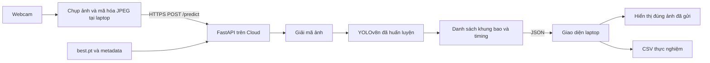

# Đặc tả đã chốt — Lab3 nhận diện khẩu trang

> Cập nhật phạm vi: nhận dạng liên tục, N khuôn mặt mỗi frame; webcam là nguồn phát triển, ESP32-CAM dự kiến là nguồn demo cuối. Kiến trúc gateway/WebSocket và interface camera trong `05_STREAMING_VA_ESP32_CAM.md` thay thế phần camera/transport ban đầu bên dưới. Cảnh ba người là test đủ ba lớp tối thiểu, không phải giới hạn số người.

Ngày lập: 10/10/2026. Đề tài do người học chọn: khẩu trang. Trạng thái: đã lập đặc tả và kế hoạch; chưa huấn luyện, chưa triển khai Cloud.

## 1. Tên đề tài và mục tiêu

**Nhận diện đồng thời tình trạng đeo khẩu trang của nhiều người từ webcam bằng mô hình học sâu nhẹ triển khai trên Cloud.**

Hệ thống phát hiện khuôn mặt trong một ảnh và phân loại từng khuôn mặt vào một trong ba trạng thái. Laptop chụp ảnh; server Cloud suy luận; laptop hiển thị kết quả và số đo độ trễ.

Demo nghiệm thu chính: một khung hình thật có ba người, mỗi người thuộc một trạng thái khác nhau. Kết quả gồm ba khung bao quanh khuôn mặt, nhãn tương ứng và confidence. Model phải được huấn luyện cho bài toán này.

Thiết bị hiện có: laptop có webcam, chưa có ESP32-CAM. Slide Lab3 cho phép camera thường hoặc camera IoT. Dùng webcam cho phiên bản hoàn chỉnh đầu tiên.

## 2. Bộ nhãn cố định

| ID | Tên trong code | Hiển thị | Quy tắc gán nhãn |
|---|---|---|---|
| 0 | `with_mask` | Đeo đúng | Đang đeo khẩu trang che cả mũi và miệng |
| 1 | `without_mask` | Không đeo | Không có khẩu trang trên mặt; khẩu trang cầm trong tay không tính là đang đeo |
| 2 | `mask_incorrect` | Đeo chưa đúng | Khẩu trang đang đeo nhưng hở mũi hoặc miệng, gồm kéo xuống cằm |

Đây là định nghĩa vận hành của bài nhận dạng ảnh, chỉ đánh giá phần che mũi/miệng nhìn thấy được. Không suy ra độ kín, chất lượng vật liệu hay hiệu quả bảo vệ từ ảnh.

- Đối tượng gán bounding box là **khuôn mặt**, không phải cả người và không chỉ riêng khẩu trang.
- Một mặt chỉ có một nhãn ground truth.
- Một ảnh có thể có nhiều mặt, kể cả nhiều mặt cùng lớp.
- Không có mặt: danh sách kết quả rỗng. Không bổ sung lớp thứ tư `background` vào bộ ba.
- Mặt không đủ rõ để xác định trạng thái: đưa ảnh vào danh sách cần xem xét. Không tự biến mặt chưa gán nhãn thành background khi đưa vào tập train.
- Khẩu trang kéo xuống cằm phải xuất hiện trong dữ liệu lớp 2 nếu muốn demo trường hợp đó.
- Nếu dataset có tên `mask_weared_incorrect`, chuyển về ID 2 và tên `mask_incorrect`; không phụ thuộc thứ tự tên theo alphabet.

## 3. Chức năng phải có

| ID | Yêu cầu | Bằng chứng nghiệm thu |
|---|---|---|
| R01 | Dataset có ba lớp, có bounding box | Thống kê ảnh và số mặt mỗi lớp; ảnh overlay nhãn |
| R02 | Có train/validation/test riêng | Manifest phân chia và báo cáo kiểm tra trùng lặp |
| R03 | Huấn luyện model học sâu nhẹ | Cấu hình, log train, weights và kết quả validation |
| R04 | Model được lưu và nạp trên Cloud | Model hash/version; log khởi động server; health API |
| R05 | Suy luận thực sự ở Cloud | Client không chạy detector; API remote trả detection và timing |
| R06 | Webcam cung cấp ảnh thật | Video demo luồng webcam tới Cloud |
| R07 | Nhận diện nhiều người cùng lúc | Cảnh có đủ ba lớp; kết quả theo từng mặt |
| R08 | Giao diện hiển thị | Khung bao, nhãn, confidence, số lượng mỗi lớp, trạng thái kết nối |
| R09 | Đo inference trên Cloud | Giá trị timing của model, định nghĩa ranh giới đo |
| R10 | Đo request khứ hồi và toàn trình | Log local và CSV gắn request_id |
| R11 | Đánh giá chất lượng và tốc độ | Kết quả test độc lập; thống kê mean/median/p95 và tỷ lệ lỗi |
| R12 | Tái chạy được | Dependencies, README, config mẫu, hướng dẫn Cloud và demo |

R01–R11 cụ thể hóa slide Lab3. R12 và các kiểm tra lỗi là tiêu chí hoàn thiện dự án đề xuất. Chỉ tiêu định lượng phía dưới do kế hoạch đặt ra, không phải thang điểm do giảng viên cung cấp.

## 4. Công nghệ chốt cho phiên bản đầu

| Phần | Lựa chọn | Cách dùng |
|---|---|---|
| Model | YOLOv8n detection, khởi tạo `yolov8n.pt` | Transfer learning cho ba lớp; giữ `best.pt` của bài |
| Train | Python + Ultralytics/PyTorch | GPU nếu sẵn có; có thể huấn luyện trên notebook Cloud |
| Backend | FastAPI + Uvicorn + Pillow/NumPy | Nhận JPEG/PNG, chạy model, trả JSON |
| Local client | Python + OpenCV + Tkinter + Pillow + requests | Webcam, giao diện desktop, HTTPS tới Cloud |
| Cloud | Hugging Face Docker Space | FastAPI chạy cổng 7860; CPU đủ để bắt đầu đo |
| Model artifact | `best.pt` + metadata JSON | Một file weights; metadata ghi nhãn, hash và cấu hình |
| Kết quả đo | CSV/JSON và biểu đồ | Dữ liệu thô có request_id, cấu hình và trạng thái |

YOLOv8n là lựa chọn cụ thể để ổn định phạm vi, không phải tuyên bố đây là model mới nhất. Dùng đúng biến thể detection; `yolov8n-cls.pt` là tác vụ khác.

Hugging Face Docker Spaces hỗ trợ triển khai container. Khả năng sử dụng, phần cứng và chi phí phụ thuộc tài khoản tại thời điểm triển khai. Chỉ triển khai khi đã có tài khoản phù hợp; nếu không, có thể dùng server Docker khác giữ nguyên API và client. Không đăng ký tài nguyên trả phí như một bước tự động.

Máy hiện có Python 3.13.9 và lệnh Docker trong PATH. Chưa kiểm tra dependencies, Docker daemon, camera, RAM hay GPU. Lệnh đọc phần cứng không được môi trường cho phép truy cập. Đề xuất Python 3.11 cho môi trường dự án và image Cloud để dùng cùng một phiên bản; không suy ra Python 3.13 chắc chắn không tương thích.

## 5. Kiến trúc



Nguyên tắc vận hành:

1. Server nạp model một lần khi khởi động, kiểm tra names, warm-up rồi mới sẵn sàng.
2. Khởi đầu một Uvicorn worker; khóa các lần gọi model để không chia sẻ predictor đồng thời không kiểm soát.
3. Client có tối đa một request đang chờ. Không tạo hàng đợi vô hạn từ mọi frame webcam.
4. Giao diện tách khu vực xem camera hiện tại và khu vực ảnh có kết quả. Khung bao vẽ lên bản sao của đúng frame đã gửi.
5. Luồng nền làm camera/request; chỉ luồng giao diện cập nhật Tkinter. Đóng ứng dụng phải giải phóng camera và dừng worker.
6. Confidence chỉ là điểm tin cậy dự đoán, không gọi là accuracy.
7. Khi lỗi mạng, kết quả cũ phải được đánh dấu cũ hoặc xóa; không trình bày như dự đoán mới.

## 6. Giao diện tối thiểu

- Ô cấu hình API URL và kiểm tra kết nối.
- Chọn camera index, mở/đóng camera.
- Nút chụp một ảnh và nút bắt đầu/dừng nhận dạng liên tục.
- Preview webcam; ảnh đã gửi có khung bao và nhãn.
- Số mặt thuộc từng lớp; tổng số mặt là tổng các số đếm.
- `request_id`, model version, inference_ms, request_ms và end_to_end_ms.
- Trạng thái: sẵn sàng, đang xử lý, không có mặt được phát hiện, timeout, lỗi server.
- Xuất CSV; nút lưu ảnh minh chứng và JSON tương ứng.

Confidence threshold khởi đầu 0.40, NMS IoU khởi đầu 0.50, ảnh JPEG 640×480 quality 80, model imgsz 640, CPU batch 1. Đây là cấu hình ban đầu để thử; chọn threshold bằng validation và khóa trước test.

## 7. API dự kiến

### GET `/health`

Trả 200 chỉ khi model đã nạp và kiểm tra hợp lệ. Trả 503 nếu chưa sẵn sàng. Chứa model version/hash, names, thiết bị và imgsz; không tiết lộ token hay đường dẫn riêng tư.

### POST `/predict`

Input: multipart field `file`, `request_id` không trùng trong cùng lượt đo. JPEG/PNG, tối đa 5 MiB, giới hạn ảnh giải mã 4096×4096 pixel cho phiên bản đầu. Đây là giới hạn đề xuất, ghi chung trong client/server.

Output minh họa dưới đây **không phải kết quả đã chạy**:

```json
{
  "request_id": "run01-0001",
  "model_version": "mask-v1",
  "model_sha256": "<hash-thuc-te>",
  "image": {"width": 640, "height": 480},
  "settings": {"imgsz": 640, "confidence": 0.4, "iou": 0.5},
  "detections": [
    {"class_id": 0, "label": "with_mask", "confidence": 0.91,
     "bbox_xyxy": [45, 60, 180, 235]}
  ],
  "counts": {"with_mask": 1, "without_mask": 0, "mask_incorrect": 0},
  "timing_ms": {
    "decode": 3.0,
    "preprocess": 2.0,
    "inference": 80.0,
    "postprocess": 4.0,
    "model_pipeline": 91.0,
    "server_processing": 98.0
  }
}
```

Tọa độ xyxy tính bằng pixel trên **ảnh gửi vào API**, không phải ảnh letterbox nội bộ của model. Nếu GUI resize hoặc mirror, phải biến đổi đồng nhất cả ảnh và tọa độ. JSON không chứa NaN/Infinity.

Ảnh hợp lệ không có detection: HTTP 200, detections rỗng, mọi counts bằng 0. Giao diện ghi “Không có khuôn mặt được phát hiện”, vì model có thể bỏ sót mặt thật.

Quy ước lỗi dự kiến: thiếu file 422; ảnh hỏng/định dạng giải mã không hỗ trợ 400; vượt giới hạn file hoặc pixel 413; model chưa sẵn sàng 503. Nếu bật token cho API remote: token sai/thiếu 401 hoặc 403, thống nhất một mã trong code và test. Client timeout mặc định connect 5s/read 15s; request timeout được lưu là lỗi, không tạo timing thành công giả.

## 8. Quy ước đo thời gian

### Server

- `decode_ms`: giải mã bytes thành ảnh.
- `preprocess_ms`, `inference_ms`, `postprocess_ms`: các mốc do Ultralytics Results.speed báo cho batch 1. Kiểm tra phiên bản thư viện và nguồn gốc giá trị khi triển khai.
- `model_pipeline_ms`: đồng hồ `perf_counter_ns` bao quanh toàn bộ model.predict; gồm preprocessing, inference và postprocessing cùng overhead.
- `server_processing_ms`: từ lúc bắt đầu handler đọc file tới lúc chuẩn bị xong response data; bao gồm chờ khóa trong handler nếu có. Không bao gồm toàn bộ framework parsing, proxy và serialization HTTP.
- Nếu GPU, dùng timer có đồng bộ GPU để tránh chỉ đo thời gian gửi lệnh bất đồng bộ.
- Không cộng lặp `model_pipeline_ms` và các số đo thành phần.

### Laptop

```text
L0: bắt đầu yêu cầu lấy frame cho lượt nhận dạng
L1: bắt đầu gửi HTTP request sau khi encode JPEG
L2: nhận đủ response body
L3: hoàn tất xử lý và cập nhật ảnh kết quả trong GUI

request_ms = (L2 - L1) / 1e6
end_to_end_ms = (L3 - L0) / 1e6
```

Mốc local dùng cùng `perf_counter_ns`. L2 lấy sau khi response bytes đã đọc, trước parse JSON nếu muốn định nghĩa nhận đủ body; L3 bao gồm parse/vẽ và chuyển kết quả sang luồng GUI. Tkinter xác định L3 ở callback sau cập nhật giao diện; báo cáo gọi đây là độ trễ trong ứng dụng, không phải phép đo quang học từ cảnh thật tới màn hình.

Với buffer camera đang chạy, có thể frame cũ hơn L0. Ghi rõ camera backend, độ tuổi frame nếu biết và giới hạn này; không tuyên bố đã đo độ trễ cảm biến đầy đủ.

### Local tới Cloud một chiều

Không thể xác định chính xác upload một chiều bằng request_ms/2 hoặc trừ timestamp khác máy. Bài này báo cáo chắc chắn ba số đo inference, request khứ hồi, toàn trình. Phần `request_ms - server_processing_ms` đặt tên thời gian ngoài handler đã đo, không gọi là độ trễ upload.

Nếu giảng viên yêu cầu upload một chiều tách riêng, cần bổ sung đồng bộ đồng hồ có sai số đã đo và timestamp nhận ở server/proxy phù hợp. Đây là điểm cần xác nhận ngoài slide, không bỏ hoặc thay tên số liệu để giả vờ đã đo đủ.

Phương án bổ sung cụ thể nằm trong mục 4 của tài liệu công việc: endpoint đồng bộ thời gian, ước lượng offset và khoảng bất định. Đây là ước lượng tới mốc nhận ảnh của ứng dụng, không phải thời gian truyền mạng thuần túy. Chỉ tuyên bố phép đo phù hợp khi ranh giới và sai số đáp ứng yêu cầu giảng viên.

## 9. Mục tiêu nghiệm thu đề xuất

Các ngưỡng là mục tiêu kỹ thuật của kế hoạch, chưa phải kết quả và không phải yêu cầu định lượng của giảng viên.

- Toàn bộ test cấu trúc dataset, API, ánh xạ nhãn, timing và xử lý lỗi bắt buộc pass.
- Chất lượng mục tiêu: test mAP50 >= 0.80; precision và recall từng lớp >= 0.70. Báo thêm mAP50-95 và số mặt mỗi lớp.
- Demo webcam theo điều kiện định trước: mỗi lớp đúng ít nhất 27/30 ảnh độc lập; cảnh ba người đủ ba lớp đúng ít nhất 9/10 ảnh.
- Định nghĩa đúng: match một-một với mặt thật, nhãn đúng, IoU >= 0.5; detection thừa cũng được ghi là FP.
- Mục tiêu trải nghiệm ban đầu: p95 end_to_end <= 2000ms, lỗi request <= 1% trong cấu hình mạng/hardware công bố. Nếu không đạt, phân tích và tối ưu; không thay thế số thực bằng mục tiêu.
- Ảnh test được chốt trước đánh giá cuối; không dùng bộ test để chọn threshold/model. Nếu quay lại điều chỉnh dựa trên test, phải tạo test mới hoặc ghi rõ kết quả đó không còn độc lập.
- Tài liệu và artifact đầy đủ có thể hoàn thành trước khi các mục tiêu model đạt; khi chưa đạt phải ghi chất lượng chưa đạt, không gọi toàn bộ hệ thống đã nghiệm thu.

## 10. Bộ đầu ra cuối

1. Mã source train, chuyển nhãn, kiểm tra dữ liệu, API, GUI, benchmark và tổng hợp số đo.
2. Dataset manifest, nguồn, chính sách nhãn, phân chia và thống kê.
3. `best.pt`, metadata gồm SHA256, names, dataset version, seed, imgsz và package versions.
4. Kết quả đánh giá model trên test, confusion matrix và ảnh lỗi.
5. API Cloud chạy được; Dockerfile và cấu hình triển khai.
6. GUI webcam chạy từ laptop.
7. CSV raw, summary JSON/bảng và biểu đồ độ trễ.
8. Test report có pass/fail thực tế và bằng chứng.
9. README, báo cáo và video demo.

## 11. Nguồn

- Đề bài chính: `3- Phat trien he thong IoT LAB 3-2.pptx`, slide 1–2.
- Nền tảng tham khảo: `3- Phat trien he thong IoT LAB 2.pptx`.
- YOLOv8 và các biến thể: https://docs.ultralytics.com/models/yolov8/
- Định dạng dataset: https://docs.ultralytics.com/datasets/detect/
- Prediction results/speed: https://docs.ultralytics.com/modes/predict/
- Validation/test và metrics: https://docs.ultralytics.com/modes/val/
- FastAPI UploadFile: https://fastapi.tiangolo.com/tutorial/request-files/
- Docker Spaces: https://huggingface.co/docs/hub/en/spaces-sdks-docker
