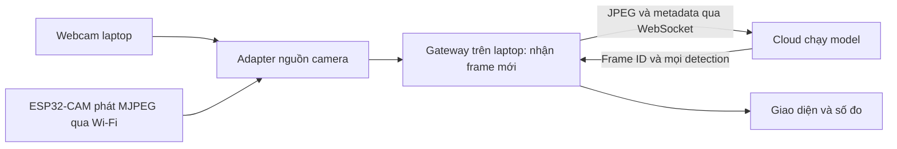

# Bổ sung đặc tả: streaming liên tục và tích hợp ESP32-CAM

Ngày cập nhật: 10/10/2026. Tài liệu này cập nhật phạm vi camera, streaming, số người và transport của kế hoạch ban đầu. Khi có khác biệt với docs/01–04, dùng quyết định trong tài liệu này cho các phần đó.

Trạng thái: đã lập thiết kế tích hợp. Chưa có firmware, adapter camera, WebSocket server/client hoặc test phần cứng đã chạy.

## 1. Kết luận từ tài liệu bài lab

- Lab3 slide1 ghi: “Từ camera thường/ camera IoT nhận dạng cùng lúc ba loại nhãn khác nhau.” Không nêu ESP32-CAM là loại camera duy nhất.
- Lab3 slide2 vẫn ghi “Coding Backend (mạch Arduino)” cùng Load model/prediction; đây là nội dung có nhắc đến mạch, không được bỏ qua khi diễn giải toàn bộ slide.
- Lab2 slide5–7 hướng dẫn ESP32-CAM và nạp code qua Arduino IDE. Lab3 được giới thiệu là mở rộng Lab2.
- Kết luận giới hạn trong nội dung được cung cấp: có căn cứ dùng webcam cho phát triển; chưa có câu bắt buộc riêng ESP32-CAM ở Lab3. Tuy nhiên chưa thể khẳng định giảng viên chấp nhận bỏ hoàn toàn mạch khỏi bài nộp.
- Quyết định dự án theo điều kiện người học: phát triển bằng webcam ngay, chuẩn bị tích hợp ESP32-CAM và dùng ESP32-CAM làm nguồn camera trong demo cuối khi có phần cứng.

Arduino IDE là công cụ nạp firmware cho ESP32-CAM; không tự có nghĩa phải dùng thêm Arduino Uno. Nếu giảng viên yêu cầu Uno, thiết bị khác, suy luận nhúng hoặc ESP trực tiếp gửi Cloud, đó là yêu cầu bổ sung chưa được xác nhận bằng câu chữ slide đã đọc.

## 2. Luồng camera và nhận dạng liên tục

Camera hoạt động liên tục sau Start. Gateway lấy frame mới theo khả năng xử lý, gửi liên tục tới Cloud và hiển thị kết quả theo frame. Chụp ảnh là chức năng lưu evidence phụ, không phải thao tác bắt buộc từng lượt nhận dạng.



Laptop giữ vai trò IoT gateway: nhận ảnh từ ESP32-CAM trong mạng nội bộ, điều phối gửi Cloud, nhận kết quả và hiển thị. ESP32-CAM là thiết bị thu nhận hình ảnh; model YOLO chạy ở Cloud.

Đây là kiến trúc IoT có gateway. Không trình bày nó như ESP32-CAM kết nối trực tiếp tới Cloud, và không coi việc có camera IoT tự chứng minh mọi yêu cầu ngoài slide đã được đáp ứng.

ESP32-CAM phát MJPEG là một stream liên tục gồm các ảnh JPEG, không đồng nghĩa codec video H.264/WebRTC. Đây là cách streaming được ví dụ CameraWebServer của Espressif hỗ trợ.

## 3. Không giới hạn số người là ba

- Ba là số loại nhãn; output là danh sách N mặt, với N thay đổi theo frame.
- Cảnh ba người chỉ là test đủ ba lớp tối thiểu.
- Test thêm cảnh 1,3,5,10 người hoặc mức khả thi có thể bố trí; ghi số mặt nhìn thấy thực tế và bbox ground truth.
- Không hardcode ba boxes hoặc ba người trong GUI/server. Kiểm tra max_det phù hợp và không bị cắt kết quả ở client.
- Số người hỗ trợ phụ thuộc kích thước mặt, khoảng cách, che khuất, độ phân giải và model. Cảnh đông nhưng mặt quá nhỏ cần camera/bố trí khác hoặc model input lớn hơn; không hứa nhận dạng số người vô hạn.

## 4. Phân tách các module ngay từ đầu

| Module | Nhiệm vụ | Có thay khi đổi camera? |
|---|---|---|
| CameraSource | Kết nối/nhận ảnh và metadata nguồn | Có: chọn webcam hoặc ESP32 MJPEG |
| FrameScheduler | Lấy frame mới, điều tiết tốc độ, bỏ frame cũ | Giữ chung |
| CloudTransport | WebSocket, reconnect, frame_id và response | Giữ chung |
| Detector Cloud | Decode/preprocess/model/postprocess | Giữ chung |
| GUI | Video/ảnh kết quả, boxes/counts/status | Giữ chung, hiển thị thêm trạng thái nguồn |
| MetricsLogger | Frame age, timing, FPS và CSV | Giữ chung, thêm loại nguồn |

Interface CameraSource dự kiến:

```text
open(config)
start()
get_latest_frame() -> FramePacket hoặc None
get_status() -> trạng thái, lỗi, thống kê nguồn
stop()
close()
```

FramePacket thống nhất:

```text
source_id, source_type, source_session_id, frame_id
jpeg_bytes, width, height
gateway_received_monotonic_ns
sensor_timestamp_optional, sensor_clock_domain_optional
```

- frame_id duy nhất trong session nguồn; reconnect tạo session_id mới để tránh đụng ID.
- Webcam adapter lấy frame bằng OpenCV và encode JPEG.
- ESP adapter đọc JPEG từ multipart MJPEG; có thể chuyển tiếp bytes JPEG gốc để tránh encode lại khi không cần resize. Decode để preview/kiểm tra dimensions vẫn cần thiết.
- Không mặc định timestamp của ESP đồng bộ với laptop. gateway_received không phải thời điểm sensor chụp ảnh.
- Adapter không chứa code model và không phụ thuộc model labels.

## 5. Cấu hình tối thiểu khi chuyển camera

Ví dụ webcam, cấu hình dự kiến chưa phải file đã được client đọc:

```json
{
  "camera": {
    "type": "webcam",
    "source_id": "camera-01",
    "index": 0
  },
  "cloud": {
    "transport": "websocket",
    "url": "wss://<cloud-host>/ws/predict"
  },
  "sampling": {
    "target_fps": 5,
    "max_inflight": 1,
    "pending_frames": 1
  }
}
```

Khi có ESP32-CAM, thay phần camera:

```json
{
  "camera": {
    "type": "esp32_mjpeg",
    "source_id": "camera-01",
    "stream_url": "http://<ip-esp32>:81/stream"
  }
}
```

target_fps5 là mức thử ban đầu, không phải tốc độ được bảo đảm. URL có IP/port thực lấy từ firmware/log và kiểm tra kết nối. Cổng81 phù hợp ví dụ CameraWebServer nếu server chính giữ cổng mặc định80; không hardcode cho mọi firmware.

Mục tiêu chuyển nguồn: chỉ đổi camera type và URL, không sửa Cloud API/model/GUI. Các bước vật lý nạp firmware, chọn board/pins, cấp nguồn và Wi-Fi vẫn bắt buộc khi có thiết bị.

## 6. Streaming transport và điều tiết tốc độ

- Endpoint WebSocket dự kiến `/ws/predict`; giữ POST `/predict` làm công cụ debug, fixture và benchmark đơn ảnh nếu hữu ích.
- Protocol frame/result dùng frame_id, source/session ID và model version. Quy định ghép metadata với binary JPEG, không ghép lẫn frame khi gửi/nhận bất đồng bộ.
- Khởi đầu một frame đang chờ inference/result, một slot pending luôn chứa frame mới nhất. Không tạo hàng đợi camera dài.
- Gateway phải tiếp tục đọc stream để bỏ frame cũ ngay cả khi Cloud đang xử lý. Chỉ đọc một frame sau mỗi response có thể để buffer mạng/camera tích tụ dữ liệu cũ.
- Điều tiết ở ứng dụng trước khi enqueue transport; WebSocket không tự loại backlog của application/TCP. Theo dõi buffer và timeout; khi mất kết nối, bỏ pending cũ và bắt đầu session mới.
- GUI giữ preview camera và kết quả gắn đúng frame. Không vẽ boxes cũ lên preview mới nếu chưa có tracking/synchronization phù hợp.
- Theo dõi source_fps, send_fps, inference_fps, result_fps, dropped_frames và frame age. Định nghĩa dropped ở từng tầng để tránh đếm hai lần.
- Kết nối liên tục không bảo đảm inference mọi frame. Báo FPS đạt thực tế và độ trễ theo cấu hình.

## 7. Firmware chuẩn bị cho ESP32-CAM

1. Dựa trên ví dụ chính thức Espressif CameraWebServer, chốt phiên bản Arduino ESP32 core và lưu cùng source firmware.
2. Chọn đúng board/camera model và pin mapping khi xác định thiết bị thực. Không mặc định mọi ESP32-CAM là AI Thinker.
3. Thiết lập Wi-Fi qua config phù hợp, không commit SSID/password thật. Ghi IP và stream endpoint qua Serial.
4. Chọn JPEG và độ phân giải khởi đầu640×480 nếu thiết bị hỗ trợ, rồi đo RAM/PSRAM, FPS, stability và chi tiết mặt. Không áp dụng độ phân giải webcam cao một cách máy móc cho ESP32.
5. Tránh bổ sung model YOLO, HTTPS Cloud token hoặc GUI vào firmware ở phiên bản gateway ban đầu.
6. Giữ cấu hình Wi-Fi/board tập trung; nếu thay SSID/password cần cơ chế provisioning hoặc nạp config lại. Có thể dùng tên mDNS/IP reservation để giảm việc đổi URL, nhưng phải thử khả năng phân giải trên laptop/mạng thực.
7. Flash đúng cách với board thực: có thể dùng USB onboard/base board hoặc USB-UART adapter. ESP32-CAM không phải mọi phiên bản đều có cổng USB trực tiếp. Chỉ chốt wiring sau khi biết loại board và adapter.

## 8. Những việc làm ngay khi chưa có mạch

- Xây CameraSource interface, webcam adapter và nguồn MJPEG giả lập.
- Nguồn MJPEG giả lập dùng webcam/video đã ghi, phục vụ multipart JPEG trong LAN, cùng contract như ESP source. Đây là mô phỏng giao thức, không mô phỏng đầy đủ sensor/nguồn điện/PSRAM.
- Xây MJPEG adapter đọc mock stream, timeout/reconnect và latest-frame buffer.
- Xây scheduler/WebSocket Cloud/GUI/metrics trên packet chung.
- Huấn luyện model và kiểm thử multi-person; chuẩn bị ảnh validation/test tương tự chất lượng camera dự kiến.
- Chuẩn bị firmware template/README từ official sample; chưa chốt pin mapping/nạp code hay claim firmware đã compile cho board thực.

## 9. Khi có phần cứng

1. Xác định board/camera sensor, USB/base/USB-UART, nguồn phù hợp và pin mapping.
2. Nạp CameraWebServer đã cấu hình, xem log Wi-Fi/IP/camera init.
3. Laptop và ESP kết nối mạng có thể truy cập nhau; tránh guest/client isolation. Kiểm tra stream trong mạng nội bộ trước Cloud.
4. Kiểm tra hình ảnh, hướng ảnh, FPS, độ phân giải và reconnect; khắc phục reset/camera init/nguồn trước model.
5. Đổi config source sang esp32_mjpeg và URL thật; Cloud model giữ nguyên.
6. Chạy lại chất lượng webcam-vs-ESP và test streaming. Nếu chất lượng ESP khác đáng kể, dùng ảnh ESP cho bổ sung train/validation, giữ test ESP độc lập. Không bảo đảm chỉ đổi URL là chất lượng sẽ giống webcam.
7. Thu log/ảnh/video và số đo để chứng minh nguồn camera IoT thật.

## 10. Test bổ sung cho nguồn IoT/streaming

| ID | Test | Expected/output |
|---|---|---|
| S01 | Webcam packet contract | Packet đầy đủ ID/bytes/dimensions/clock domain |
| S02 | MJPEG mock nhiều part/chunk boundaries | Tách JPEG đúng dù network chunk không trùng frame; đọc liên tục |
| S03 | Part lỗi hoặc incomplete/oversize | Không crash; báo lỗi, giới hạn buffer, reconnect đúng |
| S04 | Cloud chậm hơn camera | Queue giới hạn, frame được chọn là mới; memory không tăng liên tục |
| S05 | Switch webcam -> mock MJPEG | Không đổi server/model/GUI; chỉ thay config nguồn |
| S06 | Source disconnect/reconnect | Không dùng frame cũ như mới; session mới, ID không đụng |
| S07 | Streaming 15 phút | Report FPS/latency/drop/errors/memory, không backlog tăng vô hạn |
| S08 | 1/3/5/10 người theo điều kiện có thể bố trí | Output N boxes, không hardcode3; precision/recall theo mật độ mặt |
| H01 | ESP camera init/Wi-Fi/stream thật | Log boot, IP và stream có ảnh, nguồn thật được xác nhận |
| H02 | Switch mock -> ESP thật | Chỉ đổi config nguồn và xử lý hardware setup; Cloud cùng hash |
| H03 | ESP restart/mất Wi-Fi | Gateway phục hồi theo chính sách, không treo giao diện |
| H04 | ESP -> gateway -> Cloud 15 phút | Evidence continuous IoT stream và Cloud results, metrics đầy đủ |
| H05 | Chất lượng model trên ảnh ESP độc lập | Báo per-class metrics và mặt nhỏ/domain shift; không dùng webcam score thay |
| H06 | Timing boundary ESP | Gateway-receive-to-render đo đúng; sensor-to-render chỉ claim nếu timestamp/sync đã thiết kế |

Tất cả S/H tests hiện NOT_RUN. H tests cần phần cứng thực; mock test pass không đồng nghĩa ESP integration pass.

## 11. Điều chỉnh phép đo

- Giữ model inference/preprocess/postprocess trên Cloud.
- Với WebSocket, frame turnaround từ gateway bắt đầu gửi frame tới nhận đủ result của frame đó; không gọi là HTTP request time.
- Đo gateway-receive-to-GUI-result khi frame đến laptop từ ESP. Tên này không bao gồm đầy đủ sensor->Wi-Fi->gateway.
- Để claim ESP sensor->GUI toàn trình cần timestamp camera/frame origin có clock domain rõ và giải pháp sync/uncertainty; camera stream mặc định không tự cho phép trừ timestamp với laptop.
- Report loại nguồn webcam/ESP, source/session/frame_id, queue wait/frame age nếu đo được và FPS/drop metrics.

## 12. Nguồn chính thức

- Slide Lab3: `3- Phat trien he thong IoT LAB 3-2.pptx`, slide1 và2.
- Slide Lab2: `3- Phat trien he thong IoT LAB 2.pptx`, slide5–7.
- CameraWebServer: https://github.com/espressif/arduino-esp32/tree/master/libraries/ESP32/examples/Camera/CameraWebServer
- HTTP capture/MJPEG stream implementation: https://github.com/espressif/arduino-esp32/blob/master/libraries/ESP32/examples/Camera/CameraWebServer/app_httpd.cpp
- Arduino ESP32 setup: https://docs.espressif.com/projects/arduino-esp32/en/latest/installing.html
